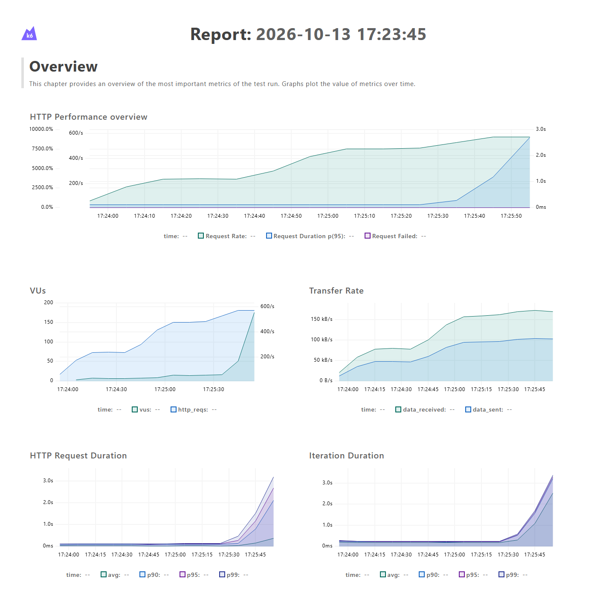
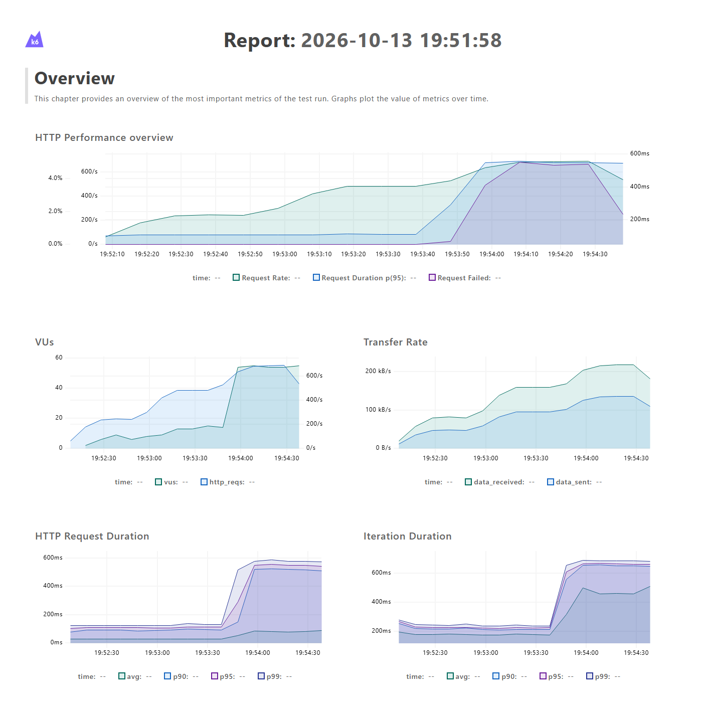
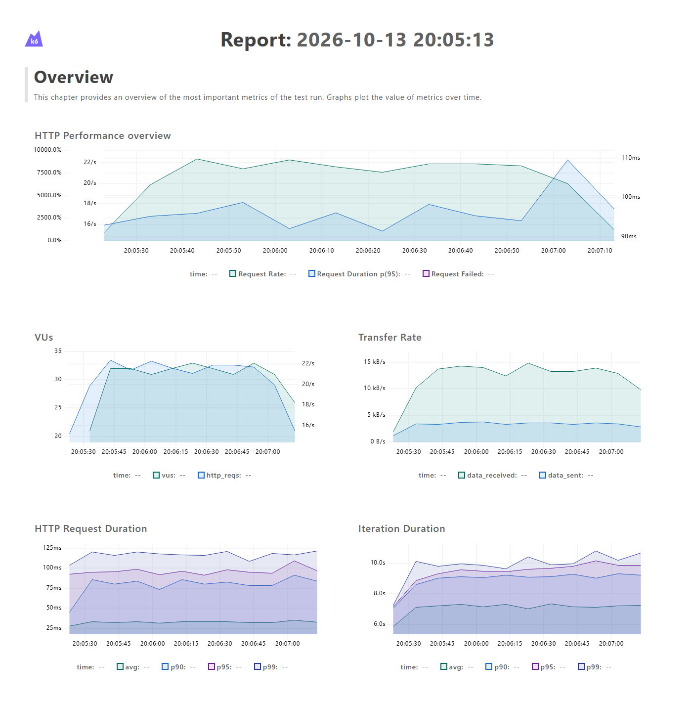
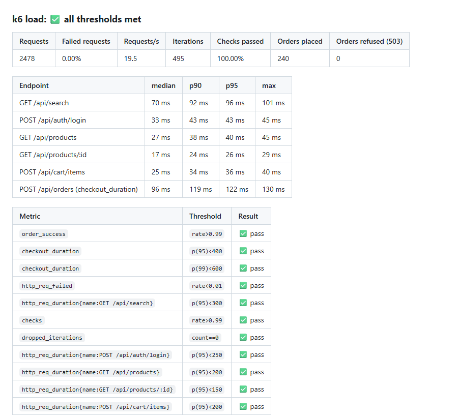
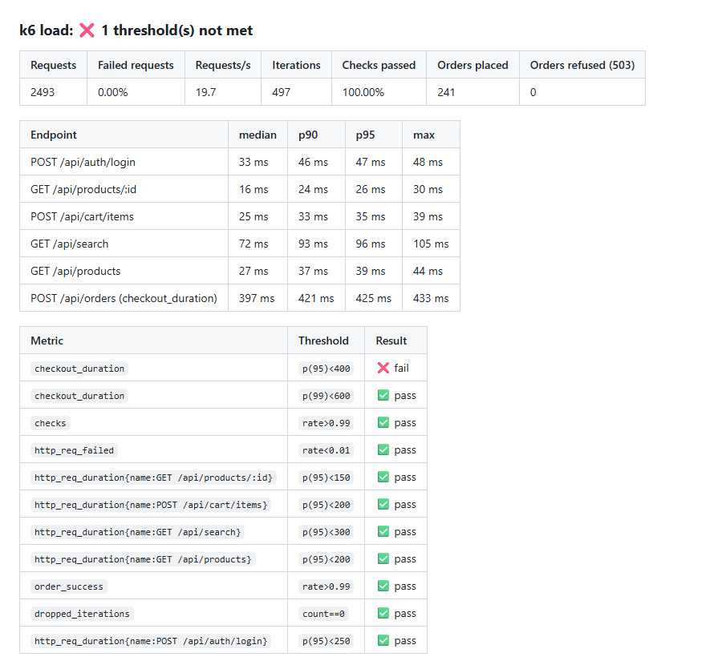

# k6 Performance Testing

[](https://github.com/niranjankagri/k6-performance-testing/actions/workflows/perf.yml)

Performance tests with **[Grafana k6](https://grafana.com/docs/k6/latest/)** for **QuickShop**, a small shop API that
lives in this repository (`app/`). Every run starts its own copy of the app, so the tests never put load on someone
else's server, and the results depend only on the code here.

| | |
|---|---|
| Tests | smoke, load, stress, spike, soak; plus a regression demo that fails on purpose |
| Pass/fail | service level objectives as k6 **thresholds**: a missed SLO makes k6 exit with 99 and fails the CI job |
| Reports | k6 web dashboard as one HTML file per test; a Markdown result table in every CI run summary; JSON of every metric |
| CI | GitHub Actions: lint and app tests, then the smoke test as a gate, then load, stress and spike in parallel; soak nightly |
| Finding | the stress test found that checkout queued without limit past about 90 orders/s; the app now sheds load (below) |

## Quick start: one command per test

New to k6? Read [docs/k6-for-beginners.md](docs/k6-for-beginners.md): what each test does, how to read the results,
and what the words mean.

```
npm install          # once
npm run smoke        # or: load, stress, spike, soak, regression
```

Each command starts its own copy of the shop, runs the test with live charts in the browser, saves and opens the
HTML report, stops the shop, and prints PASSED or FAILED (`scripts/run.js`). Add `-- --no-open` to skip the browser.

## Tech stack

| Tool | Version | Used for |
|---|---|---|
| k6 | 2.3.0 | load generator, scenarios and executors, checks, thresholds, custom metrics, web dashboard |
| JavaScript (ES modules) | | test scripts (k6 runs its own JavaScript runtime, not Node) |
| Node.js | 24 | the QuickShop demo API (no dependencies) and its functional tests (`node --test`) |
| ESLint + Prettier | 10.12 / 3.9 | lint and format for the app, the scripts and the workflow |
| GitHub Actions | | pipeline, `grafana/setup-k6-action` |

## The app under test: QuickShop

QuickShop is a plain Node HTTP server with in-memory data: 50 products, 500 test users, carts and orders. Every
endpoint waits a little, like a real one, and search is the slowest read.

**Checkout needs one of 8 "database connections"** for 60-120 ms. This gives the app a real bottleneck of about
8 / 0.09 s ≈ 90 orders per second.

| Endpoint | | Typical time |
|---|---|---|
| `POST /api/auth/login` | token for `user001`..`user500` (password in `data/users.csv`) | 15-35 ms |
| `GET /api/products`, `GET /api/products/:id` | list (filter by category), one product | 5-30 ms |
| `GET /api/search?q=` | search the names | 40-90 ms |
| `GET/DELETE /api/cart`, `POST /api/cart/items` | the user's cart (token needed) | 5-25 ms |
| `POST /api/orders`, `GET /api/orders/:id` | check out, read an order (only your own) | 60-120 ms + waiting for a connection |
| `GET /health` | status, uptime, server memory (`rssMb`), number of orders | at once |

These environment variables change the app's behaviour for experiments:

- `PORT`;
- `CHECKOUT_DELAY_MS`, which simulates a "slow release";
- `DB_POOL_SIZE`;
- `MAX_WAITING`, the load-shedding limit (`0` turns it off).

`app/server.test.js` checks the API's behaviour with 10 tests, because a load test of an app that gives wrong
answers measures nothing.

**Why the app is in this repository:** the tests run against their own copy, started fresh for every run, locally and in
CI. No shared or hosted environment means no outages, no test data shared between runs, and no change somewhere else
that breaks these tests; one clone and one command run everything. It is also built for these tests: load and stress
tests can push it to its limits without touching anyone's production system.

## Project structure

```
k6-performance-testing
├── app/
│   ├── server.js             QuickShop HTTP API (routes, auth, load shedding)
│   ├── shop.js               data and rules: products, users, carts, orders, the connection pool
│   └── server.test.js        functional tests of the API (node --test)
├── data/users.csv            500 test users
├── k6/
│   ├── lib/
│   │   ├── config.js         BASE_URL, PROFILE (ci | full), THINK; byProfile() picks the sizes
│   │   ├── api.js            one function per endpoint, each request tagged with a stable name
│   │   ├── data.js           users in a SharedArray, categories, search terms
│   │   ├── flows.js          user journeys browse() and buy(): checks, think time, custom metrics
│   │   ├── thresholds.js     the SLOs, per endpoint
│   │   └── summary.js        end-of-test output: console, JSON, Markdown table
│   └── tests/
│       ├── smoke.js          1 user, every journey, zero failures allowed
│       ├── load.js           expected peak: visitors + customers, against the SLOs
│       ├── stress.js         orders per second in steps past the limit: where and how does it break?
│       ├── spike.js          visitors x30 within 10 s, then back: survive and recover?
│       └── soak.js           steady load for hours, server memory sampled every 10 s
├── reports/                  output of the runs (not in git)
├── scripts/run.js            npm run <test>: starts the shop, runs k6 with live charts, opens the report
├── docs/                     beginner guide, design notes, interview questions, report screenshots
└── .github/workflows/perf.yml
```

## How a test is built

```
k6/tests/load.js     options: scenarios (who, how many, which executor) + thresholds (the SLOs)
      │  exec: browsing / buying
k6/lib/flows.js      browse(), buy(): the steps of a user, checks, think time, business metrics
      │
k6/lib/api.js        HTTP calls with a stable "name" tag per endpoint
      │
QuickShop            started by the job, at BASE_URL
```

What happens in `k6 run k6/tests/load.js`:

1. **init**: every VU (virtual user) loads the script. `data.js` reads `users.csv` once into a `SharedArray`, which
   all VUs share. `options` is built for the chosen `PROFILE`.
2. **setup()** runs once. `requireHealthyApp()` stops the run at once if the app is not up.
3. **Scenarios run in parallel**, each with its own executor:
   - `browsers` (`ramping-vus`, a *closed* model): 20 visitors; each starts the next visit when the last one ends.
   - `buyers` (`constant-arrival-rate`, an *open* model): 2 new orders start every second, however slow the app
     is. k6 adds VUs when iterations take longer, up to `maxVUs`.
4. **Each iteration** is one journey. In `buy()`, the VU:
   1. logs in, once per VU, and keeps the token;
   2. clears the cart;
   3. adds 1-3 products;
   4. reads the cart;
   5. places the order;
   6. reads the order back.

   It pauses between steps (think time) and checks every answer with `check()`, including that the order total
   matches the cart.
5. **Metrics**: k6 records every request (`http_req_duration`, `http_req_failed`, ...), tagged with the endpoint
   name. The journeys add business metrics:
   - `checkout_duration` (Trend);
   - `orders_placed` and `orders_refused` (Counters);
   - `order_success` and `order_handled` (Rates).
6. **Thresholds** are checked during the run and at its end. A missed threshold makes k6 exit with 99.
7. **handleSummary()** writes the console summary, `reports/load-summary.json` and `reports/load-summary.md`. With
   `K6_WEB_DASHBOARD_EXPORT` set, k6 also writes the HTML dashboard report.

## The tests

| Test | Question it answers | Load (ci profile) | Passes when |
|---|---|---|---|
| `smoke.js` | do the system and the scripts work at all? | 1 VU, 30 s | no failed request, every check passes, endpoint SLOs met |
| `load.js` | does a normal peak meet the SLOs? | 20 visitors + 2 orders/s, 2 min | all SLOs met, no dropped iterations |
| `stress.js` | where is the limit, and is the failure graceful? | 0 → 40 → 80 → 120 orders/s in steps, no think time | every order placed correctly or refused with 503; checkout p95 < 1.5 s |
| `spike.js` | does a sudden burst break it, and does it recover? | 5 → 150 visitors in 10 s, back to 5, + 2 orders/s | < 2% failed requests, looser response-time limits |
| `soak.js` | is it as fast after hours as after minutes? | 10 visitors + 2 orders/s for 4 min (full: 4 h) | all SLOs met; server memory within budget |

The **SLOs** are in `k6/lib/thresholds.js`. The p95 response time per endpoint must stay under:

- products list: 200 ms;
- one product: 150 ms;
- search: 300 ms;
- login: 250 ms;
- add to cart: 200 ms;
- checkout: 400 ms (p99: 600 ms).

Also, fewer than 1% of requests may fail, and more than 99% of checks and orders must succeed.

Each test has two sizes:

- **`PROFILE=ci`** (the default) runs in minutes on a laptop or a CI runner.
- **`PROFILE=full`** has realistic sizes and durations for a dedicated environment, for example 200 visitors and
  20 orders/s for 20 minutes, or a 4-hour soak.

## Finding: checkout had no limit, now it sheds load

The first stress run (commit `fdc40a9`) showed flat checkout times up to 80 orders/s. At 120 orders/s, every
checkout queued for a connection, without any limit. p95 passed 3 s and was still rising when the abort threshold
stopped the run.



The fix (commit `a1989a2`): when 40 checkouts already wait for a connection, a new one gets `503 Service Unavailable`
with `Retry-After: 1` at once. The same stress test then ran through all its steps:

- 10,639 orders placed and 1,350 refused;
- the slowest checkout took 624 ms;
- every answer was correct, and reads were not affected.

`MAX_WAITING=0` brings back the old behaviour.



## Setup

1. Install [k6](https://grafana.com/docs/k6/latest/set-up/install-k6/) (2.x) and Node.js 22 or newer.
2. Then run:

```
git clone https://github.com/niranjankagri/k6-performance-testing.git
cd k6-performance-testing
npm install                 # ESLint and Prettier only; the app has no dependencies
```

## Running

The easiest way is the Quick start above (`npm run <test>`). To run k6 directly instead, start the app in one
terminal:

```
npm start                   # QuickShop on http://localhost:3000
```

Run the tests in another terminal:

```
k6 run k6/tests/smoke.js
k6 run k6/tests/load.js
k6 run -e THINK=0 k6/tests/stress.js
k6 run k6/tests/spike.js
k6 run k6/tests/soak.js
k6 run -e PROFILE=full k6/tests/load.js            # realistic size and duration
k6 run -e BASE_URL=https://staging.example.com k6/tests/smoke.js
```

Check the app and the scripts:

```
npm run test:app            # functional tests of the API
npm run lint                # ESLint + Prettier
```

**Regression demo** (fails on purpose): start a "slow release" and run the load test against it.

```
CHECKOUT_DELAY_MS=300 PORT=3001 node app/server.js
k6 run -e BASE_URL=http://localhost:3001 k6/tests/load.js     # exit code 99: checkout p95 above 400 ms
```

## Reports

- **HTML dashboard**: set `K6_WEB_DASHBOARD=true` and `K6_WEB_DASHBOARD_EXPORT=reports/load-report.html`. The file
  has charts over time (request rate, VUs, response-time percentiles, failures) and a table of every metric. CI
  keeps it as an artifact of every test job.
- **Markdown summary** (`reports/<test>-summary.md`) shows:
  - requests, failures, iterations and orders;
  - p50/p90/p95/max per endpoint;
  - every threshold, with pass or fail.

  CI adds it to the run's summary page.
- **JSON** (`reports/<test>-summary.json`): every metric, for comparing runs or for another tool.
- **Console**: k6's end-of-test summary.

Load test dashboard (ci profile):



Load test summary, as it appears on the CI run page:



The regression demo: everything still works functionally (100% of checks pass). But checkout p95 is 425 ms, against
an SLO of 400 ms, so the run fails:



## CI (GitHub Actions)

`.github/workflows/perf.yml` runs on every push and pull request, every night and on demand:

1. **Lint + app tests**: ESLint, Prettier, and the API's functional tests.
2. **Smoke test** as the gate: the bigger tests only start when the smoke test has passed.
3. **load, stress and spike** run in parallel, one job each (`fail-fast: false`). **soak** runs only nightly and on
   demand.

Every test job:

- starts its own QuickShop;
- installs k6 with `grafana/setup-k6-action`;
- writes the Markdown summary to the run summary page;
- uploads `reports/` (HTML dashboard and JSON) as an artifact.

A manual run (Run workflow) can pick one test, the `full` profile, or the regression demo.

Load from a shared CI runner is good enough to catch regressions at these sizes. For capacity numbers that hold for
production, run `PROFILE=full` from dedicated load generators against a production-like environment.

## More

- [docs/k6-for-beginners.md](docs/k6-for-beginners.md): run the tests and read the results without knowing k6.
- [docs/framework-design.md](docs/framework-design.md): the design decisions and their reasons.
- [docs/interview-questions.md](docs/interview-questions.md) ([PDF](docs/interview-questions.pdf)): 78 performance
  testing and k6 interview questions, each linked to the code here.
